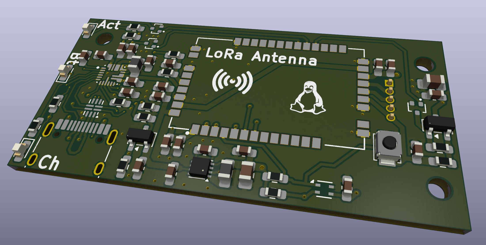

# PawBuddy
> Status: PCB Designed, ordered. CAD need to be drawn up  
> This is my Graduation Project. YAY  
> **V1.2**  

It's aiming at making cheaper alternatives to classic GSM, GPS or propriatery radio dog trackers.  

  

## PCB Features
- RAK3640
- 3A charging
- indication LED's
- PCB art! Even in the schematic. ;)
- minimal footprint (25x51)
- mounting holes

## Manufacturing files

Gerber, drill, BOM, position, and netlist files are included in the versioned production archives under [`PCB/production/`](PCB/production/).  

Open the project in KiCad 9 or newer to inspect or modify the schematic and PCB. PDF exports and an interactive HTML BOM are also available in the production directory.  

## Bill of materials

The complete BOM is available as:

- [`BOM.ods`](BOM.ods) - all of the components for this prject
- [`PCB/production/bom.csv`](PCB/production/bom.csv) - just the PCB cmponents

## References
https://heltec.org/project/mesh-node-t114/  
https://docs.rakwireless.com/product-categories/wisduo/rak4630-module/datasheet/#schematic-diagram  
https://github.com/meshtastic/firmware/tree/develop/variants/nrf52840/rak4631  
